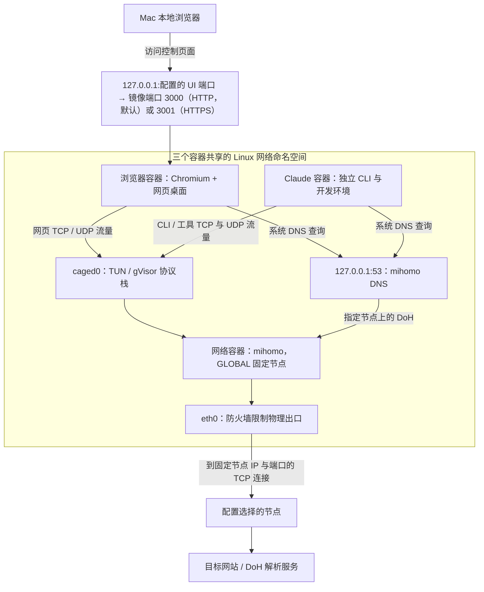

# Caged Claude 实现原理

本文说明当前 `caged-claude` 的实际实现：后台运行独立的 Chromium、Claude Code 与网络网关三个容器，两个应用通过同一个受控网络空间访问公网，并在代理失效时阻止回退直连。

日常使用见 [README](../README.md)。本文对应 2026-11-20 的代码，不包含节点密码、订阅内容或运行时控制密钥。

## 1. 整体结构

正常使用时有三个独立容器：

| 组件 | 默认名称 | 职责 |
| --- | --- | --- |
| 网络容器 | `caged-claude-network` | 安装防火墙，运行 mihomo、TUN 和 DNS，连接选定代理节点 |
| 浏览器容器 | `caged-claude-browser` | 运行 Chromium 与网页桌面，加入网络容器的网络命名空间 |
| Claude 容器 | `caged-claude-claude` | 保持独立的开发环境与持久化状态目录，加入同一个网络命名空间；CLI 按需执行 |
| 宿主入口 | `./cage`（`up`、`down`、`status`、`claude`、`shell`、`logs` 等子命令） | 后台启动、明确停止、状态查看、日志与进入 Claude CLI 或容器 Shell |

`verify`、`audit` 会临时增加一个无额外能力的检查容器，检查结束后删除。它不是日常运行所需的第四个服务。



本机打开的页面负责显示远程桌面、传递鼠标和键盘；网站请求由容器里的 Chromium 发起。因此，本机访问控制页面的连接与容器访问网站的连接是两条不同路径。

## 2. 为什么独立的应用容器能共用网络

browser 和 claude 启动时都使用：

```text
--network container:<网络容器的不可变 ID>
```

这使三个容器共用网络接口、IP、路由表、回环地址和防火墙。两个应用都没有额外的 Docker 网络出口；网络容器中的 `127.0.0.1:53` 对它们来说也是本地 DNS。

三者的文件系统和进程空间仍然分开。应用不会因为共享网络，就自动获得网关中的代理配置、控制密钥或修改防火墙的权限。

网关持有 `NET_ADMIN` 和 `/dev/net/tun`，用于在容器网络空间内创建 TUN、安装路由和防火墙。browser 和 claude 均没有 `NET_ADMIN`，并显式移除 `NET_RAW`；检查容器使用 `--cap-drop ALL`。这些操作发生在 OrbStack 的 Linux 环境里，不需要修改 Mac 路由，也不需要 Mac 的 `sudo`。

## 3. 一次启动的顺序

### 3.1 统一解析配置

`caged/host/config.py` 先确定应用 YAML：`--settings` 优先于 `CAGED_CLAUDE_SETTINGS`，再使用项目内的 `config/app.yaml`。该文件保存节点选择、节点文件路径、期望国家、DoH、时区、locale、语言、UID/GID、共享内存大小、实例名和 UI/控制器/mixed/DevTools 端口。

每个字段再按“命令行参数 > 对应的 `CAGED_CLAUDE_*` 环境变量 > 应用 YAML > 内置默认值”独立解析。节点文件默认 `mihomo.yaml`，实例名默认 `caged-claude`；这些与常规 DoH、locale、语言、UID/GID、共享内存和端口默认值集中保存在 `caged/host/config.py` 的 `DEFAULTS`。实际配置可以省略这些项，`config.example/app.yaml` 将所有可选项注释并注明默认值。节点与时区没有内置地区偏好。

browser 与 claude 的应用用户名固定为 `claude-user`。UID/GID 默认值为 `host`，在每次解析时取启动者身份：launcher 容器内使用入口脚本传入的 `CAGED_HOST_UID` / `CAGED_HOST_GID`，宿主直接运行时调用 `os.getuid()` / `os.getgid()`，显式整数按同样的配置优先级覆盖。镜像构建不依赖某一台 Mac 的数字身份。浏览器派生镜像在构建时重命名上游账号，并同步适配其 s6 服务与桌面默认脚本中的账号引用，保留原有的运行时 PUID/PGID 重映射；Claude 启动脚本调整同名账号。运行策略和签名环境探针也核对固定用户名及实际 UID/GID。

只有最终生效的值进入类型与范围校验，低优先级中被覆盖的无效值不会错误地阻止启动。无默认值的选项缺失、键名拼错或生效值非法时，在创建容器前失败；显式填写无效值不会被默认值掩盖。

`proxy.file_path` 省略时读取应用 YAML 同目录的 `mihomo.yaml`，填写相对路径时也以该目录为基准；CLI/环境变量指定的相对路径以调用目录为基准。旧 YAML 键 `proxy.config` 及旧环境变量、CLI 别名仍兼容。`proxy.expected_country` 可用两位国家代码，也可以设为 `null`/`any` 取消国家限制；其他网络检查继续执行。完整字段映射见 [配置参考的配置优先级](configuration.md#配置优先级)。

解析后的非机密策略通过 `CAGED_CLAUDE_POLICY` 传给网关、浏览器、Claude 和检查容器；每次执行探针也显式传入同一份策略。节点密码仍仅通过网关标准输入传输。这样改变时区、语言或国家时，生成配置、真实运行和审计的期望值同步变化。

### 3.2 顺序启动

`./cage up` 按依赖顺序启动三个容器：

1. 检查实例名称和本地端口是否可用。
2. 从 `proxy.file_path` 指定的节点文件（默认应用 YAML 同目录的 `mihomo.yaml`）读取 `proxy.node`，检查是否为当前支持的独立节点（TCP 上的 TLS）。
3. 将节点服务器域名解析并固定为真实公网 IPv4，同时保留 SNI。
4. 按项目源码哈希检查镜像，必要时构建。
5. 后台启动网络容器，通过 `docker exec -i` 的标准输入将节点参数写入其私有 tmpfs 中的启动文件；网关读完后删除该文件。
6. 网关先安装 IPv4/IPv6 默认拒绝防火墙，再生成临时配置并启动 mihomo。
7. 确认 TUN 已建立，运行模式为 `global`，`GLOBAL` 已固定到 `CAGED_NODE`。
8. 启动器核对防火墙、DNS 与实际 HTTPS 出口，按生效的 `proxy.expected_country` 核对国家。
9. 业务网络保持关闭，启动浏览器容器，使其加入同一网络命名空间；先检查本地实际 DNS 策略、语言、时区和网页桌面入口。
10. 启动 Claude，核对同一份时区、locale、语言、UID/GID、CLI 版本和授权目录可写。
11. 给两个应用的只读环境探针分别注入 root 私有密钥。网关验证随机挑战、会话身份、配置摘要和实际环境，再获取新鲜 DNS 与出口证据，更新内核限时许可。
12. 放行后再验证真实 Chromium 与 Claude 的普通网络路径。检查通过后启动命令返回；network 内持续监控，后续通过 `./cage status` 和 `./cage down` 管理。

网关未就绪、DNS 失败或出口不符合配置策略时，本次启动会报错并进入清理。浏览器检查失败也会结束本次会话。显示访问地址不代表运行了完整 `audit`；完整故障演练需要单独执行。

## 4. 如何复用 Clash Verge 配置

应用与节点配置分别是：

```text
config/app.yaml      # 应用启动配置
config/mihomo.yaml   # 默认的节点文件，可通过 proxy.file_path 更换
```

本机现有节点文件完整复制自 Mac Clash Verge 的生成配置，权限为 `600`；整个 `config/` 目录均已加入 Git 忽略。仓库保留 [config.example/app.yaml](../config.example/app.yaml) 和 [config.example/mihomo.yaml](../config.example/mihomo.yaml) 两份模板，其他环境可复制并填写自己的启动选项和节点参数。

`--settings` 可以指定其他应用文件，`--proxy-file-path` 可以指定其他节点文件。省略节点文件设置时，默认寻找所选应用 YAML 同目录的 `mihomo.yaml`。更新 Mac 配置不会自动改动项目快照，需要重新复制。

宿主程序用 PyYAML `safe_load` 读取 `proxies`，按解析后的 `node` 精确选择节点。`nodes` 列出所有地区，不再按新加坡名称过滤。容器拿到的是该节点的一次配置快照，不是 Mac Clash 的 HTTP/SOCKS 监听地址。

容器里的配置由程序重新生成，关键部分是：

```yaml
mode: global
proxies:
  - name: CAGED_NODE
    # 其余字段来自选定的独立节点（AnyTLS、Trojan、VLESS、VMess，见 configuration.md）
proxy-groups: []
rules: []
```

启动后还会通过 mihomo 控制接口确认 `GLOBAL` 选择的是 `CAGED_NODE`。因此，项目快照中保留的原始规则、策略组选择和运行模式不会直接成为容器策略。更换节点通过 `--node` 完成；修改项目配置快照后需要重启容器读取，不做实时同步。

支持 TCP 上 TLS 的独立节点：AnyTLS、Trojan、VLESS、VMess（后两者需 `tls: true`，含 Reality），协议表在 `caged/shared/protocols.py`，启动器和网关共用。带有 `dialer-proxy` 的链式节点会被拒绝，避免只复制末端节点却遗漏前置链路。节点的 SNI、TLS 校验等参数沿用源配置，程序不自动改写其校验强度；只在 `server` 被换成固定 IP 时，为空的 TLS 名称字段（`sni` 或 `servername`）和 `ws` 的 `Host` 头补上原域名。

## 5. 网站流量如何到达代理

Chromium 发起网站连接后，容器内路由将相应流量送入 `caged0`。mihomo 使用 gVisor 协议栈处理这些 TCP/UDP 流量，再按全局配置交给指定节点。

mihomo 自身使用 `eth0` 连接已固定的节点 IP，避免代理连接再次进入 TUN 形成循环。节点支持的 UDP 也由代理转发；本项目保留 UDP 能力，并通过 STUN 检测其实际出口。IPv6 外网流量则阻断。

浏览器和网关的常见代理环境变量都被清空，包括大小写形式的 `HTTP_PROXY`、`HTTPS_PROXY`、`ALL_PROXY`、`NO_PROXY`。浏览器不依赖应用是否遵守这些环境变量，主要约束来自共享网络中的 TUN 与防火墙。

宿主网络仍承载“连接远端节点”的底层通信，可能影响延迟和可用性。启动器不关闭、不改写宿主 TUN、系统代理或路由。宿主开着 TUN/VPN 时，到节点的那一跳经宿主拨号器、绑定物理网卡发出，见 [架构：宿主 TUN 与拨号器](architecture.md#宿主-tun-与拨号器)。网关这一侧的变化：mihomo 的节点地址改为拨号器端点（macOS/Windows 为 `host.docker.internal:<端口>`，防火墙只放行它；Linux 为网关内 `127.0.0.1` 上的转发口，转发到挂载的 Unix socket，`eth0` 上不放行任何目标），SNI 保持节点域名；多个节点地址由拨号器按顺序尝试，不再使用 fallback 组。

## 6. DNS 为什么需要单独约束

### 6.1 浏览器交给系统，系统交给容器网关

容器解析器仅配置：

```text
nameserver 127.0.0.1
```

浏览器派生镜像中安装受管策略：

```json
{
  "DnsOverHttpsMode": "off",
  "BuiltInDnsClientEnabled": false
}
```

这让 Chromium 使用系统解析路径，避免浏览器另选一套内建 DNS/DoH。这里关闭的是 Chromium 自己的 DoH；上游 DNS 仍由 mihomo 加密发送。

### 6.2 上游 DoH 显式指定代理节点

mihomo 的 DNS 监听在 `127.0.0.1:53`，上游为：

```text
<proxy.dns_upstream>#CAGED_NODE
```

例如，示例配置会生成 `https://1.1.1.1/dns-query#CAGED_NODE`。`dns_upstream` 可以列 1–4 个端点，每个都生成一行；mihomo 同时查询并采用第一个可用应答，SERVFAIL 不会被当作结果。DoH URL 当前要求公网 IPv4 字面地址、HTTPS 和查询路径，不接受额外凭证、query 或 fragment，避免引入未经约束的域名引导；节点标识由程序追加。`#CAGED_NODE` 显式指定该上游经选定节点连接。完整路径是：

```text
Chromium → 系统解析器 → 127.0.0.1:53
         → mihomo → 配置选择的节点 → 配置选择的 DoH 服务
```

节点服务器填域名时，启动器同时向节点文件 `dns.proxy-server-nameserver` 中的安全 DoH 和 `proxy.bootstrap_dns` 查询 A 记录，校验证书，按顺序取第一个含公网 IPv4 的应答，并固定其中最多 4 个地址。网关防火墙只放行这些地址；多于一个时，mihomo 的 `CAGED_NODE` 是一个 fallback 组，健康检查经节点访问 generate_204，在地址之间切换。全部服务都失败时停止启动，并列出每个服务的原因。填公网 IPv4 的节点直接使用配置的地址。

这一步在隧道建立之前，只能经宿主网络进行；应答可信靠的是 HTTPS 证书校验，而不是“哪个解析器更权威”。DNS 检查失败时，网关用 mixed 代理经节点逐个请求 `dns_upstream` 端点，报错写明每个端点是应答、超时、TLS 失败还是 HTTP 错误。

### 6.3 fake-IP 不是实际公网解析结果

当前使用 fake-IP 模式，范围为 `198.18.0.1/16`。浏览器的普通 A 记录查询可能先得到该范围中的地址，mihomo 再利用映射识别原始域名并建立代理连接。

因此，看到 fake-IP 只能说明本地 DNS 应答路径工作，不能单独证明上游 DoH 可用。检查还会发送一个带随机名称的新鲜 TXT 查询，要求收到含权威区信息的否定响应；这种响应不能靠 A 记录的 fake-IP 分配来替代。

### 6.4 公共 DNS 不能作为直连备用

防火墙在允许 TUN 流量前，拒绝非回环的 UDP/TCP 53、853 请求。应用直接指定公共 DNS 或 DoT 服务时，不会因此获得额外出口。本地 `127.0.0.1:53` 的业务请求和响应也必须持有未到期的联网许可。

网页自己构造的 HTTPS/DoH 请求属于普通 HTTPS，仍会经全局代理。本项目不解密 HTTPS 内容，也不将这类请求强制改写到固定解析服务。DNS 服务的 IP 地理标签也不等于浏览器出口国家；本项目验证的是配置指定的 DoH 通道与出口策略。

## 7. 防火墙如何阻止回退直连

防火墙由内核维护，独立于 mihomo 的代理规则。IPv4 的 `INPUT`、`FORWARD`、`OUTPUT` 默认策略均为 `DROP`。

IPv4 `OUTPUT` 按以下顺序处理：

| 顺序 | 条件 | 处理原因 |
| --- | --- | --- |
| 1 | mihomo 标记的、到固定节点 IP/端口的 `eth0` TCP | 仅维持代理核心的外层传输；应用不能设置此标记 |
| 2 | 网页桌面已建立连接的响应 | 保留控制页面，无需授予公网业务权限 |
| 3 | 回环 DNS | 请求和响应先通过 `CAGED_GATE` 验证许可或网关诊断标记 |
| 4 | 其他回环 | 保留受鉴权 API、本地环境探针及本地开发服务 |
| 5 | 其他出站流量 | 先经过 `CAGED_GATE`；许可到期直接丢弃，位置早于通用已建立连接放行 |
| 6 | 非回环 UDP/TCP 53、853 | 进入 `CAGED_DNS` 丢弃，防止公共解析绕过 |
| 7 | 私网、元数据及特殊地址段 | 进入 `CAGED_PRIVATE` 丢弃 |
| 8 | 通过前述规则的 TUN 流量 | 交给 mihomo 代理；其他出站进入 `CAGED_DIRECT` 丢弃 |

IPv6 的输入、转发、输出也默认拒绝，仅允许回环。IPv4 输入保留网页桌面与代理核心的回包，其他业务回包也先校验许可，从而限制已有下载流。诊断连接的 connmark 只允许回包方向复用；新发起的 UDP 即使复用旧诊断五元组也不能继承放行。

当 mihomo 停止或 TUN 消失时，应用即使尝试从 `eth0` 直连普通网站，也无法绕过独立防火墙。浏览器等进程仍持有网络命名空间时，内核中的防火墙不会随网关容器退出而自动消失。这也是故障测试保留检查容器的原因。

物理出口同时限制接口、节点 IP、端口和 mihomo 的 socket mark。browser 与 claude 没有 `NET_ADMIN` 并移除 `NET_RAW`，不能伪造这个标记或网关探针标记。节点协议的握手仍由 mihomo 实现。

### 7.1 内核许可、监控与恢复

`caged/runtime/network/lease.py` 使用 ipset `hash:net` 的两项 `/1` 前缀覆盖 IPv4 源地址，更新时通过临时集合与 `swap` 原子替换。每项都有内核 timeout，最长默认 90 秒；未续期时由内核过期，不依赖监控线程醒来删规则。放行之前还扣除探针结果在进程调度中滞留的时间，过期结果不能重新授权。配置后端不可用会拒绝启动，没有长期放行的兼容降级。

`caged/runtime/network/monitor.py` 在 network 内运行。默认每轮结束后等待 5 秒核对代理/防火墙、应用系统环境和浏览器策略；每次成功网络复检完成 30 秒后再检查 DNS 与出口。全部通过才续期；网络采样暂不可用时保留剩余许可但不延长，环境证据缺失则关闭，明确违规则锁定。临时故障按 15 秒起、上限 300 秒指数退避。人为暂停与已确认违规只有明确恢复命令才能解除。

后台检查不导入或调用 `caged/runtime/checks/browser.py`，也不依赖 CDP。浏览器容器的只读探针读取 `/etc/chromium/policies/managed/caged-network.json`，将配置与系统环境一并签名回传；网关用同一份期望值核对。实际 `Intl`、`navigator` 与 `chrome://policy` 的验证保留在启动和显式 smoke/audit，因而日常巡检不会创建或关闭标签、改变焦点。磁盘配置核对不等于持续证明每个网页的 JavaScript 环境，报告按这个范围取证。

两个应用各有只读 `caged/runtime/agents/environment.py`，仅监听共享回环。启动器通过 stdin 给各容器 `/run/caged-agent.json` 写入不同的 root-only 密钥，网关 tmpfs 保存对应验证材料；不放入 Docker 环境变量、工作区或镜像。响应绑定随机 nonce、角色、实例会话和整个运行策略摘要，防止伪造旧实例与重放。端点不能运行任意命令或转发网络。

探针由容器自身管理：browser 使用依赖 `init-services` 的 s6 longrun 服务，claude 由 PID 1 在入口脚本完成系统初始化后启动，并在退出后延迟一秒重新拉起。启动器只注入注册材料，不通过 `docker exec -d` 启动探针。手动重启应用容器后，探针随容器重新启动并复用原注册身份；Claude 每次启动先删除旧就绪标记，避免初始化期间上报尚未恢复的环境。探针不可用期间仍按原规则断网，恢复有效环境报告和新鲜网络证据后由监控器按退避周期自动恢复；手动暂停和已锁定违规仍需显式恢复。

暂停时保留网络容器。网关诊断进程用受能力保护的 `SO_MARK` 发起固定 DNS/HTTPS 探针，经同一 TUN 和选定节点，其他出站限制仍然生效。DNS 查询和 TLS socket 都显式标记，TLS 继续验证目标证书。应用无法取得这种能力；mixed 代理有独立随机鉴权，未认证连接必须返回 407。恢复检查不会临时打开整个公网。

`./cage pause` 通过 Docker 管理入口写入私有暂停意图并立即清除许可；`./cage resume` 只请求新检查。控制写入与续期使用文件锁，暂停期间或尚有恢复请求时不准续期，避免慢探针覆盖新的用户操作。网关状态查询同时读取实际内核剩余时间，监控进程卡住时也不会仅显示旧的成功记录。

## 8. 管理接口与浏览器设置

默认发布的 Docker 端口只有：

```text
127.0.0.1:<ports.ui> → 共享网络空间中的 TCP 3000（browser.ui_scheme: http，默认）或 3001（https）
```

网页桌面服务运行在浏览器容器，端口发布配置放在网络容器，因为端口属于共享网络空间。`--port` 修改的是 Mac 上的本地端口。

其他接口不发布到宿主：

| 接口 | 地址 | 用途与约束 |
| --- | --- | --- |
| mihomo 控制器 | `127.0.0.1:<ports.controller>` | 核对模式和节点；每次启动生成随机密钥，匿名访问应返回 401 |
| mihomo mixed 代理 | `127.0.0.1:<ports.mixed>` | 受随机密码保护，应用不能通过它绕过暂停；TUN 主链路不使用 |
| Chromium DevTools | `127.0.0.1:<ports.debug>` | 创建专用诊断标签、读取真实浏览器状态，检查后关闭该标签 |

共享回环意味着同一网络空间里的进程可连接这些接口。控制器依靠鉴权进一步保护；其密钥仅放在网络容器文件系统中，浏览器没有挂载该目录。

时区和语言同时在多层设置：系统 `TZ`、`/etc/timezone`、`/etc/localtime` 来自根上的 `timezone`（省略时按节点出口选择）；容器的初始化脚本在启动时设置时区文件，镜像不再固定时区。`LANG` 与 `LC_ALL` 来自根上的 `locale`；Chromium 使用 `browser.language`，并自动追加不带地区的语言回退项。

浏览器检查读取实际的 `Intl.DateTimeFormat()`、`navigator.language`、`navigator.languages` 和 `chrome://policy`。时区以浏览器自身的规范名称比较；系统检查核对时区文件是否指向同一个 zoneinfo 文件，以及该时区当前的实际 UTC 偏移，因此不固定 `+0800`，也适用于夏令时和合法的时区别名。

浏览器保留 Chromium 原生标签栏和地址栏，不使用 `--kiosk`，也不添加系统标题栏。启动前恢复 `browser.custom_chrome_frame=true`，并将 GTK 的 `gtk-decoration-layout` 设为 `:`，隐藏 Chromium 自绘的窗口关闭、最小化和最大化按钮；Openbox 使用 `NO_DECOR` 取消额外标题栏。`containers/browser/session.sh` 负责运行和重启浏览器：关闭最后一个标签、关闭最后一个窗口或进程退出后，自动重新打开 `chrome://newtab`。`--disable-background-mode` 避免关闭所有窗口后仍留下无窗口的后台进程。镜像通过 `HARDEN_DESKTOP`、`HARDEN_OPENBOX` 禁止桌面菜单、终端、sudo 和外部打开工具，并禁用 Selkies 应用启动、文件传输及命令接口；剪贴板和正常的 DevTools/CDP 保持可用。`./cage shell browser` 仍是宿主侧的管理入口。

## 9. 进程与数据生命周期

### 9.1 服务入口与后台容器

`./cage up` 使用 `docker run -d --rm` 启动三个服务，检查通过后返回，不保留前台监督进程。启动中断或任何一步失败时，只回滚清理本次创建的容器。`./cage down` 按 Claude、浏览器、网关的顺序停止，并等待自动删除完成后返回，避免紧接着启动时名称仍被占用。绑定的宿主数据不随容器删除。

容器带有项目路径、随机会话 ID 等标签。清理前核对所有权，避免同名容器或其他启动器的实例被误删。浏览器按网关不可变 ID 加入网络，避免容器名称被替换后误连到另一实例。

`./cage status` 显示各容器状态。网关意外消失时，应用容器可能仍然存在，但内核默认拒绝防火墙继续限制它们；状态命令会标注网关不可用。恢复方式是 `./cage down` 后重新 `./cage up`，不是给客户端换到其他网络。

`./cage claude` 校验实例所有权与网关 ID，然后 `docker exec` 到已运行的 Claude 容器执行 CLI。执行用户取容器实际的 PUID/PGID，使用其实际环境和工作目录，不用后来修改的配置去猜运行时身份。交互终端使用 `-it`，非交互 `-p` 场景只使用 `-i`；参数原样传给 Claude。退出对话只退出这次 exec，不停止容器。

`./cage shell` 与 `./cage claude` 共用 `caged/host/enter.py` 的所有权、网关和身份校验，默认执行 Claude 容器内的 `bash -l`；也可选择 browser 或 network。network 使用其已有的 `sh`。`--root` 只改变此次容器内 exec 的 UID/GID、HOME 和用户环境，普通应用仍以 `claude-user` 运行。分隔符 `--` 后的命令按参数数组传给 Docker，不经过宿主 Shell 二次展开。

容器仍是 `--rm` 的临时外壳；Claude 环境与浏览器资料保存在宿主 `state/<实例>/`，每次启动重新挂载，见 [有状态环境设计](stateful-service.md)。

### 9.2 Workspace 与授权目录

可选的 `workspace` 支持路径或路径列表，经过展开和规范化后，以相同绝对路径读写挂载到两个应用；首项是工作目录。设置缺省时不挂载任何 workspace。Claude 的 HOME 是 `/home/claude`，浏览器的是 `/config`。不会递归修改 workspace 的属主，也不会隐式共享 Mac 主目录。系统目录、持久化的状态挂载（`/var`、`/opt`、`/srv`、`/root`、`/home/claude`）和只读运行时 `/caged-runtime` 不能被 workspace 覆盖。

Claude 凭证默认绑定 `<state.dir>/<实例>/claude` 到容器 `/home/claude/.claude`，并设置 `CLAUDE_CONFIG_DIR=/home/claude/.claude`。凭证 `.credentials.json`、设置、会话、记忆及 `.claude.json` 都保存在这个目录中。新实例通过 `./cage claude` 登录。

`claude.config_dir` 可使用实例 `claude/` 目录或其子目录，兼容原来显式配置的项目 `config/` 子目录。状态目录权限为 `700`，必要的属主调整只限该专用目录。镜像构建上下文通过白名单排除私有配置和授权目录。Docker 构建器安装软件和拉取镜像，应用启动后使用共享网关的受控出口。

### 9.3 数据放在哪里

| 数据 | 保存位置 | 清理方式 |
| --- | --- | --- |
| 应用启动配置 | 项目 `config/app.yaml` | Git 忽略；会话结束后保留，修改后重启读取 |
| Claude 授权、设置、会话与记忆 | `<state.dir>/<实例>/claude` 绑定到容器 `/home/claude/.claude` | `./cage down` 和容器重建后保留 |
| 宿主桥的主机密钥与日志 | `<state.dir>/<实例>/bridge-host` | 由宿主监听器使用，与容器内的只读桥接挂载分开 |
| 实例登记 | `<项目>/state/.instances/<实例>.json` | 在 `state.dir` 指定的磁盘不可用时仍可校验 |
| Claude 的系统与 HOME | `state/<实例>/system`、`state/<实例>/home`，分别绑定到 `/etc`、`/usr`、`/var`、`/opt`、`/srv`、`/root` 与 `/home/claude` | 实时写在宿主；容器删除、Docker 重装后保留 |
| 明示 workspace 文件 | 原宿主绝对路径 | 两个应用访问同一份文件；宿主修改和容器修改互相可见 |
| 代理配置快照 | 项目 `config/mihomo.yaml`，从 Mac 配置完整复制 | 权限 `600`、Git 忽略；会话结束后保留，不自动同步源文件 |
| 选定节点参数 | 启动器内存，经标准输入传给网关 | 从项目快照读取，不额外写入其他项目文件、容器环境变量或镜像 |
| 网关配置、控制密钥、核心日志 | 网关 `/run/caged` tmpfs | 网关容器删除后释放 |
| 网关临时文件 | `/tmp` tmpfs | 容器删除后释放 |
| 浏览器配置、登录状态、缓存、下载文件 | `state/<实例>/browser` 绑定到浏览器 `/config` | 实时写在宿主；容器删除后保留 |
| 镜像与构建缓存 | Docker/OrbStack 镜像存储 | 作为安装产物保留，正常会话退出不删除 |

浏览器镜像本身的系统仍是临时的，只持久化 `/config` 资料；网关固定主机名为实例名，使 Chromium 的配置锁跨重启有效。Claude 的探针与 entrypoint 从项目只读挂载到 `/caged-runtime`，不在持久化状态中。网关根文件系统只读，运行时写入限于 tmpfs。临时容器不表示运行期间完全没有磁盘写入，也不表示绑定文件会被自动删除。

后台服务启动成功后独立于启动终端存在；通过对应实例的 `./cage status`、`./cage down` 检查和结束。令牌有效期由 Claude 的认证机制管理，持久化文件不等于令牌永不过期。

## 10. 11 项检查如何取证

实例运行中时，`audit` 附加到当前实例；否则创建一组新的临时容器。两种模式都会在检查前后读取防火墙和计数器，并运行真实流量探针。故障演练：当前实例用 `ip rule add uidrange 65533-65533 lookup main priority 100` 让专用 UID 绕开 TUN 路由，模拟代理消失；一次性实例真正移除自己的网关，验证剩余网络空间没有回退出口。

| 检查 | 核心证据 |
| --- | --- |
| 环境外出站约束 | IPv4/IPv6 默认拒绝规则与安装快照一致；物理接口探针导致 `CAGED_DIRECT` 计数增加；浏览器仅加入指定网关网络 |
| 终端检测通道 | 不使用代理环境变量的 HTTPS 请求经多个出口 IP 服务（并发补位）与定位服务（按顺序）得到符合生效国家策略的实际出口 |
| DNS 与解析约束 | 解析器仅为回环；本地 UDP/TCP 查询与新鲜 TXT 递归响应成功；显式节点 DoH 配置；公共 UDP/53、TCP/53、DoT/853 失败且 DNS 丢弃计数增加 |
| 系统时区与语言 | 实际环境、时区文件、UTC 偏移和 locale 一致 |
| 浏览器时区与语言 | 专用标签读取 `Intl`、`navigator`、实际 DNS 策略与浏览器出口 |
| 共享文件与宿主私有目录 | 精确核对明示 workspace 与 Claude 状态目录的挂载白名单，拒绝额外绑定；无 Docker socket 或网关运行凭证文件；随机令牌在 Claude 状态目录往返读写，宿主私有目录中的探针文件在环境内不可见 |
| 宿主管理接口 | 字面 IP 的元数据/网桥管理端口探针失败且私网丢弃计数增加；控制器匿名访问 401；浏览器能力边界与已发布端口符合预期 |
| 代理故障关闭 | 当前实例：专用 UID 失去代理路由后 HTTPS、UDP、公共 DNS 失败，`CAGED_DIRECT` 计数增加，演练前同一 UID 有成功对照。一次性实例：删除网关后，检查容器与 Claude 的 TCP/DNS/UDP，以及浏览器新鲜字面 IP 导航失败；浏览器禁用缓存并绕过 Service Worker |
| UDP 出站约束 | 真实 STUN 得到代理出口；物理 UDP 不在出口白名单中 |
| IPv6 出站约束 | 全局 IPv6 地址为 0；实际 IPv6 外网请求失败；有 IPv6 默认路由时 IPv6 默认拒绝计数增加 |
| 出口符合已保存规则 | 出口 IP 不在内置大陆网段且定位不是 CN；终端 HTTPS 与浏览器国家符合生效策略（如配置国家限制），当前 TCP、UDP、browser、claude 采样出口 IP 一致 |

仅“请求失败”可能是服务本身不可用，不能自动等同于隔离生效。本地回归测试先证明替身 TCP、UDP、UDP/53、TCP/53、TCP/853 服务可连通，再验证网关运行及移除后均被阻断；真实审计同时使用内核丢弃计数增加作为证据。

报告初始状态为 `unknown`，完成对应证据后才设为 `passed`；确认违规设为 `failed`。每项独立判定，一个探针失败只影响依赖它的项。不是 11/11 时以非零退出码结束；不会补齐成虚假的 11/11。

### 验证命令的区别

| 命令 | 范围 |
| --- | --- |
| `./cage check test` | 配置优先级、校验和跨组件传递；本地可连通替身、隔离与代理删除测试、启动器和子进程生命周期；不使用真实节点凭证 |
| `./cage check verify` | 真实节点的 HTTPS、DNS、UDP、物理接口及 IPv6 检查，再移除自己的网关验证断网 |
| `./cage check smoke` | 启动真实 Chromium 和 Claude 服务，检查环境、DNS、出口与网页桌面入口，完成后清理 |
| `./cage check audit` | 实例运行中：在当前实例上完整 11 项检查，故障演练不中断使用 |
| `./cage check audit --instance caged-audit --port 3003` | 新实例中的完整 11 项检查，真实删除网关做故障演练，完成后清理 |

## 11. 当前实现的范围

启动会验证 DNS、模式、防火墙、出口策略与两个应用的环境设置，network 内持续监控并续期内核许可。Mac 不需要常驻监督脚本，不修改宿主代理、TUN 和路由；`./cage` 只读取宿主路由与系统代理端口，用于 `proxy.host_tunnel` 和管理接口检查。宿主拨号器随实例存在：路由清空后自行退出，崩溃时网关连不上节点、许可到期断网，`./cage up` 会重新拉起。运行策略是启动快照，宿主应用 YAML 的编辑在重新启动后生效。后台不重复删除网关的完整故障演练；期望国家沿用 `proxy.expected_country`，中国大陆出口始终拒绝；不承诺永久固定公网 IP，周期采样也不代表逐条连接的出口证明。出口定位结果在网关内缓存 6 小时，避免频繁请求第三方定位服务。

本项目的 UDP 策略是经节点转发，与 Claude-Cage 的默认 UDP 阻断策略不同。IPv6 则直接阻断。文件系统隔离根据挂载结构和具体私有路径取证，不是对宿主所有文件逐个做读取测试。

这些约束建立在宿主、Docker/OrbStack 和项目镜像可信的前提上。宿主 Docker 管理员能够修改容器与网络；容器共享的是 OrbStack Linux 内核，项目不提供独立虚拟机级的安全边界，也不处理账号、Cookie、字体、Canvas 等完整浏览器指纹。

## 12. 源码阅读入口

宿主编排、容器运行时和共享协议各自成包。`caged/host` 依赖 `shared`，不会为日常命令导入容器服务；`runtime` 不依赖宿主编排。三个镜像都使用项目根目录作为构建上下文，只复制自己的运行代码与共享模块，私有 `config/`、宿主脚本和测试不进入镜像。

每个 `Session` 持有自己的不可变 `Instance`，包含 network、browser、claude 和临时 check 的名称；没有修改当前实例名称的全局开关。清理继续核对项目标签、会话身份和容器不可变 ID。

镜像源码哈希从对应 Dockerfile 的实际本地 `COPY` 输入递归计算，同时包含 Dockerfile 和 `.dockerignore`。修改被复制的共享模块会使相关镜像重建，无须在宿主程序里维护另一份依赖清单。容器通过 `python3 -m caged.…` 执行包内模块，设置 `PYTHONPATH=/opt` 和 `PYTHONSAFEPATH=1`，避免挂载工作区中的同名包覆盖运行时。

| 文件或目录 | 对应实现 |
| --- | --- |
| [cage](../cage)、[caged/host/main.py](../caged/host/main.py)、[containers/launcher](../containers/launcher) | 唯一的 sh 入口；`help`/`init` 由 shell 完成，其余子命令在 launcher 容器（或 `CAGED_NATIVE=1` 时在宿主）分派到宿主 Python 包，保留调用者工作目录 |
| [caged/host/cli.py](../caged/host/cli.py)、[session.py](../caged/host/session.py) | 命令分派、启动检查、后台会话与失败回滚 |
| [caged/host/instance.py](../caged/host/instance.py)、[docker.py](../caged/host/docker.py)、[images.py](../caged/host/images.py) | 独立实例名称、Docker 所有权与清理、实际构建输入及镜像哈希 |
| [caged/host/config.py](../caged/host/config.py)、[proxy.py](../caged/host/proxy.py)、[yamlfile.py](../caged/host/yamlfile.py) | 配置优先级与校验、安全 YAML 加载、节点选择和地址固定 |
| [caged/host/shell.py](../caged/host/shell.py)、[enter.py](../caged/host/enter.py)、[claude.py](../caged/host/claude.py)、[logs.py](../caged/host/logs.py) | 共用身份与所有权检查，进入容器 Shell、Claude CLI 或查看日志 |
| [caged/host/hostbridge.py](../caged/host/hostbridge.py)、[bridge.py](../caged/host/bridge.py)、[caged/runtime/hostpipe.py](../caged/runtime/hostpipe.py) | 宿主桥：launcher 侧的挂载与计划、宿主侧监听与按需启动的 `sshd -i`、容器侧的 socket 中转（见 [宿主桥设计](host-bridge.md)） |
| [caged/host/audit.py](../caged/host/audit.py) | 11 项取证编排：当前实例或一次性实例，逐项通过/失败/未知 |
| [dialer](../dialer)、[caged/host/dialer.py](../caged/host/dialer.py) | 宿主拨号器（Go，绑定物理网卡转发到固定节点）与启动器侧的路由登记、对照结果和路径选择 |
| [caged/runtime/network/main.py](../caged/runtime/network/main.py)、[mihomo.py](../caged/runtime/network/mihomo.py)、[firewall.py](../caged/runtime/network/firewall.py) | 网关生命周期、全局代理与 DNS 配置、防火墙 |
| [caged/runtime/network/monitor.py](../caged/runtime/network/monitor.py)、[lease.py](../caged/runtime/network/lease.py) | 持续检查、限时许可、退避恢复与人工暂停 |
| [caged/runtime/agents/environment.py](../caged/runtime/agents/environment.py) | 两个应用的只读签名环境探针 |
| [caged/runtime/checks](../caged/runtime/checks) | CLI 网络探针、多源出口与定位（egress.py）、策略快照、显式浏览器检查、文件边界探针、Claude 与系统环境取证 |
| [caged/shared/policy.py](../caged/shared/policy.py)、[protocol.py](../caged/shared/protocol.py) | 运行策略、固定用户名、国家校验与签名消息编码 |
| [caged/shared/mainland.py](../caged/shared/mainland.py) | 内置中国大陆 IPv4 网段（APNIC 分配给 CN 的地址）；`python3 -m caged.shared.mainland delegated-apnic-latest` 重新生成 |
| [containers/network](../containers/network)、[browser](../containers/browser)、[claude](../containers/claude) | 各自的 Dockerfile 与镜像初始化文件 |
| [tests/unit](../tests/unit) | 无 Docker 的配置、监控状态转换和模块结构回归 |
| [tests/integration](../tests/integration) | 真实 Docker 生命周期、挂载持久化、网络约束与内核到期断网 |
| [tests/fixtures](../tests/fixtures) | 测试服务、流量程序和启动器替身 |

已有旧布局实例可以继续使用 `status`、`stop` 和 `claude`。状态与人工暂停命令按实例标签兼容旧许可模块路径；下次正常重新启动时使用新包布局，无需迁移配置字段。

### 相关参考

- [Docker：共享容器网络命名空间](https://docs.docker.com/engine/network/#container-networks)
- [mihomo：TUN](https://wiki.metacubex.one/en/config/inbound/tun/)
- [mihomo：DNS 配置与指定代理](https://wiki.metacubex.one/en/config/dns/)
- [Chromium：DnsOverHttpsMode 策略](https://chromeenterprise.google/intl/en_ca/policies/dns-over-https-mode/)
- [Claude-Cage：参考的网络检查逻辑，固定源码版本](https://github.com/Lee-xeo/Claude-Cage/blob/b6a8cf8271ad29b05f08b3e07d306e4dd8c32bbf/internal/workbench/safety.go)
- [Claude Code：容器中持久化授权与设置](https://code.claude.com/docs/en/devcontainer#persist-authentication-and-settings-across-rebuilds)
